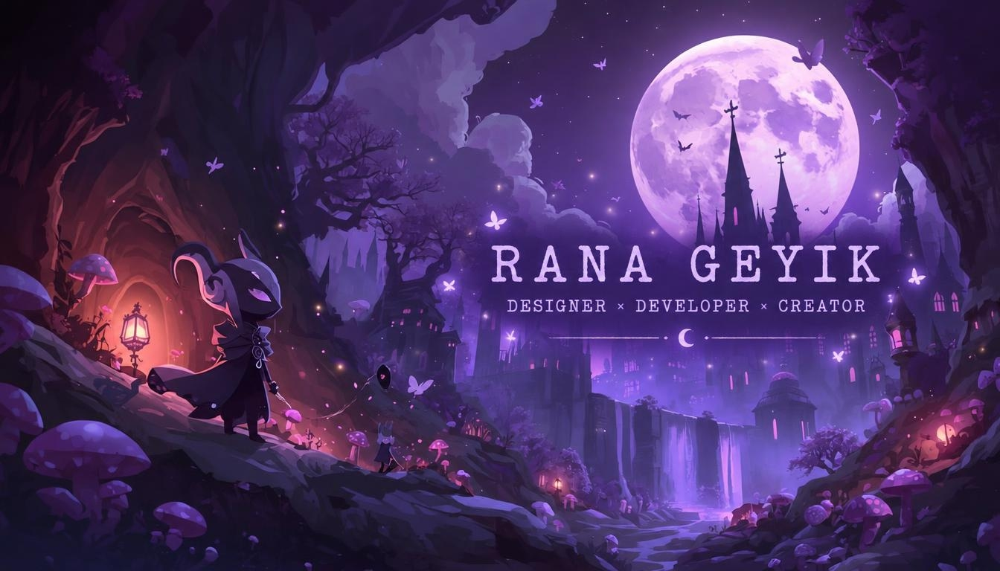

  

<h1 align="center">Hi, I'm Ra! ✨</h1>

  <strong>Designer × Developer · Full-Stack Software Engineer</strong> 
  Independent product builder exploring AI-native development, one useful idea at a time.

  
  

---

### TECHNOLOGY ECOSYSTEM

Project-backed tools first; active build areas and future interests are labeled separately. No proficiency scores.

#### Hands-on · documented in my profile and projects

  
  
  
  
  
  
  
  
  
  
  

Hands-on reflects the existing profile and visible project manifests, not a claim of mastery.

#### Actively exploring · current project architecture

<table>
  <tr>
    <td width="50%" valign="top">
      <strong>AI-native application patterns</strong> 
      An evolving TypeScript AI package with agent-session and prompt foundations.
    </td>
    <td width="50%" valign="top">
      <strong>Product and data architecture</strong> 
      Monorepo boundaries, shared application packages, and a typed database access layer.
    </td>
  </tr>
</table>

  

    <strong><code>▶ TECHNOLOGY INTERESTS // FUTURE EXPLORATION</code></strong> 
    <code>NOT CLAIMED AS HANDS-ON</code>
  

   
  <table border="1" bordercolor="#285A2A" bgcolor="#10120F">
    <tr>
      <td width="50%" valign="top" bgcolor="#10120F">
        <strong><code>LANGUAGES &amp; WEB FOUNDATIONS</code></strong> 
        JavaScript · PHP · SQL · HTML5 · C · C++ · Java · Rust · Dart
      </td>
      <td width="50%" valign="top" bgcolor="#10120F">
        <strong><code>FRONTEND</code></strong> 
        Astro · Bootstrap · Sass / SCSS · Material UI · Framer Motion · Zustand · Redux Toolkit · TanStack Query · React Hook Form · Zod
      </td>
    </tr>
    <tr>
      <td width="50%" valign="top" bgcolor="#10120F">
        <strong><code>BACKEND &amp; APPLICATION PATTERNS</code></strong> 
        Express.js · Hono · Laravel · Symfony · Django · FastAPI · Flask · Spring Boot · REST APIs · GraphQL · WebSockets · Authentication · Authorization · Server-Side Rendering · Server Actions · Background Jobs
      </td>
      <td width="50%" valign="top" bgcolor="#10120F">
        <strong><code>DATABASES &amp; DATA</code></strong> 
        MySQL · SQLite · MongoDB · Redis · Supabase · Prisma ORM · Drizzle ORM · Elasticsearch · Database Design · Relational Modeling · Data Modeling · CRUD · Query Optimization · Database Migrations
      </td>
    </tr>
    <tr>
      <td width="50%" valign="top" bgcolor="#10120F">
        <strong><code>AI &amp; MACHINE LEARNING</code></strong> 
        OpenAI API · Anthropic API · Gemini API · LLM Integration · Prompt Engineering · AI Agents · Agentic Workflows · RAG · Embeddings · Vector Databases · LangChain · LlamaIndex · Hugging Face · Ollama · MCP · AI-Assisted Development · AI Automation · Structured Outputs · Tool Calling
      </td>
      <td width="50%" valign="top" bgcolor="#10120F">
        <strong><code>INFRASTRUCTURE &amp; DELIVERY</code></strong> 
        Linux · Ubuntu · WSL2 · Docker · Docker Compose · GitHub Actions · CI/CD · Vercel · Netlify · Cloudflare · Nginx · Apache · AWS · Google Cloud · Azure · Environment Configuration · Deployment · Monitoring · Infrastructure as Code
      </td>
    </tr>
    <tr>
      <td width="50%" valign="top" bgcolor="#10120F">
        <strong><code>TESTING &amp; CODE QUALITY</code></strong> 
        Jest · Vitest · Playwright · Cypress · React Testing Library · PHPUnit · Pytest · ESLint · Prettier · TypeScript Strict Mode · Static Analysis · Integration Testing · End-to-End Testing · Test Automation
      </td>
      <td width="50%" valign="top" bgcolor="#10120F">
        <strong><code>DESIGN &amp; CREATIVE TECHNOLOGY</code></strong> 
        Adobe Photoshop · Adobe Illustrator · Adobe Premiere Pro · Blender · UI/UX Design · Design Systems · Responsive Design · Prototyping · Wireframing · Interaction Design · Motion Design · Visual Storytelling
      </td>
    </tr>
    <tr>
      <td width="50%" valign="top" bgcolor="#10120F">
        <strong><code>COMMERCE &amp; PRODUCT ENGINEERING</code></strong> 
        WordPress · WooCommerce · Shopify · Headless Commerce · Product Catalog Architecture · PIM · Inventory Systems · Marketplace Architecture · Search &amp; Filtering · Payment Integrations · API Integrations · Authentication Systems · Role-Based Access Control · SaaS Architecture · Multi-Tenant Systems · Analytics &amp; Dashboards
      </td>
      <td width="50%" valign="top" bgcolor="#10120F">
        <strong><code>DEVELOPER WORKFLOW</code></strong> 
        VS Code · Cursor · GitHub Copilot · Postman · Insomnia · npm · yarn · Vite · Webpack · Turbopack · Swagger / OpenAPI · Notion · Linear · Jira · Redmine
      </td>
    </tr>
  </table>

### 🏰 MY WORLDS / PROJECTS

<table>
  <tr>
    <td width="50%" valign="top">
      <h3>🔮 <a href="https://github.com/ranageyik/raya-lab">Raya Lab ↗</a></h3>
      
Open experiments in AI-native products, rapid MVP systems, full-stack prototypes and creative technology.

      
TypeScript · Public playground

    </td>
    <td width="50%" valign="top">
      <h3>🌙 RaDreams</h3>
      
A private, local-first dream journal.

      
TypeScript · Private project

    </td>
  </tr>
  <tr>
    <td width="50%" valign="top">
      <h3>🌌 NAKSHATRA</h3>
      
A personal world in progress.

      
Project details and technology not listed

    </td>
    <td width="50%" valign="top">
      <h3>🪄 Independent creations</h3>
      
Personal experiments, digital tools and creative ideas evolving into products.

      
Always exploring · Details vary by project

    </td>
  </tr>
</table>

### INTERESTS // OFF-SCREEN

<code>ANIME · GAMES · MUSIC · ART · PHILOSOPHY · CREATIVE EXPLORATION</code>

---

  <em>Drawn to mysterious worlds, meaningful music and stories that stay.</em>

### 🦋 A little reminder

  <em>"Even in the darkest places, beauty waits to be found."</em>

  ✦ · · · ───── 🌙 ───── · · · ✦

  <em>Was immer du tun kannst oder träumst es zu können, fang damit an. Kühnheit besitzt Genie, Macht und Magie.</em> 
  — Johann Wolfgang von Goethe 
  From Türkiye, to the world. 💜

