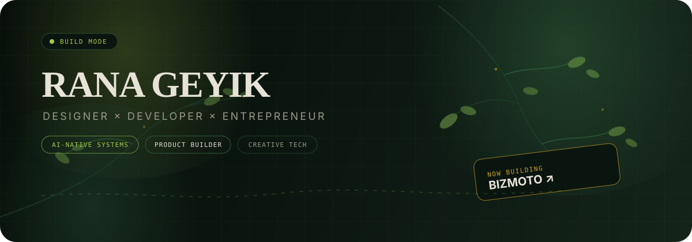

 

  

  <strong>✦ I turn complex ideas into human, scalable systems. ✦</strong> 
  Product Builder · Full-Stack Developer · AI-Native Creator

  
  

---

### 🌙 A little about my world

I work at the intersection of product design, full-stack engineering and AI-native technology.

I enjoy turning complex ideas into human, accessible and scalable digital experiences.

I explore, experiment, design and build — from the first sketch to working products.

*Somewhere between engineering logic and creative chaos, I build things that feel alive.*

### ✧ My abilities

<table>
  <tr>
    <td width="50%" valign="top">
      <h3>01 · 🏰 Product systems</h3>
      
Product strategy, architecture, design systems and end-to-end user journeys.

    </td>
    <td width="50%" valign="top">
      <h3>02 · 🦋 Creative direction</h3>
      
Visual design, art direction, storytelling, music and experimental digital experiences.

    </td>
  </tr>
  <tr>
    <td width="50%" valign="top">
      <h3>03 · 🔮 AI-native workflows</h3>
      
Agent-assisted development, RAG, automation and intelligent systems.

    </td>
    <td width="50%" valign="top">
      <h3>04 · ⚔️ Full-stack execution</h3>
      
Interfaces, APIs, data architecture, deployment and production operations.

    </td>
  </tr>
</table>

### 🪻 Current quests

<table>
  <tr>
    <td>⚔️</td>
    <td><strong>BUILDING</strong></td>
    <td>Digital products</td>
  </tr>
  <tr>
    <td>🔮</td>
    <td><strong>EXPLORING</strong></td>
    <td>AI agents & intelligent apps</td>
  </tr>
  <tr>
    <td>🏰</td>
    <td><strong>CREATING</strong></td>
    <td>Raya Lab</td>
  </tr>
  <tr>
    <td>🦋</td>
    <td><strong>LEARNING</strong></td>
    <td>Creative technology</td>
  </tr>
  <tr>
    <td>✧</td>
    <td><strong>BELIEVING</strong></td>
    <td>Make complexity feel obvious.</td>
  </tr>
</table>

### 🏰 Worlds I'm building

<table>
  <tr>
    <td width="50%" valign="top">
      <h3>🔮 <a href="https://github.com/ranageyik/raya-lab">Raya Lab ↗</a></h3>
      
Open experiments in AI-native products, rapid MVP systems and creative technology.

      
Public playground · Built in the open

    </td>
    <td width="50%" valign="top">
      <h3>🌱 Independent creations</h3>
      
Personal experiments, digital tools, creative applications and ideas evolving into products.

      
Always exploring · Always building

    </td>
  </tr>
</table>

### 🧪 My inventory

  
  
  
  
  
  
  
  
  
  

### 🌌 Beyond the terminal

  
  
  
  

*I like mysterious worlds, beautiful details, music that makes me feel something, and stories that stay with me.*

### 🦋 A little reminder

  <i>"Even in the darkest places, something beautiful is waiting to be discovered."</i>

  ✦ · · · ───────── 🌙 ───────── · · · ✦

  <strong>Designing futures that are useful, alive and unmistakably human.</strong> 
  From Türkiye, building for the world. 💜

